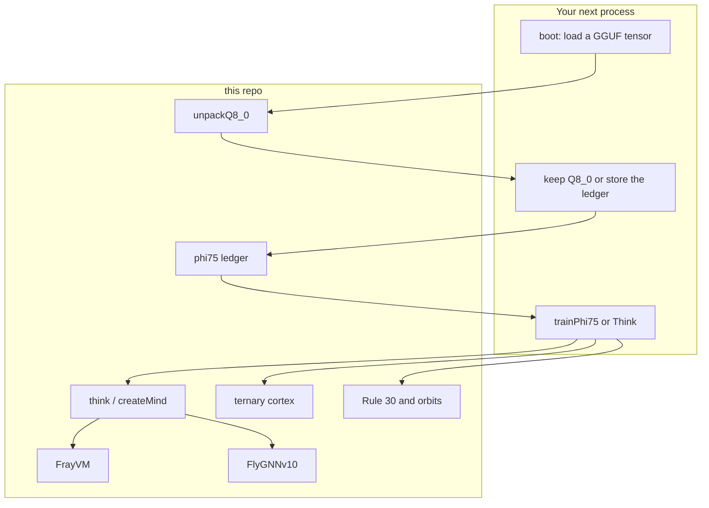

<p align="center">
  <b>◈ FRAYMUS BRAIN</b><br>
  The studio brain, lifted out so a new project can import it and start an AI operating system from this kernel.
</p>

<p align="center">
  <a href="https://github.com/eyeoverthink/fraymus-css">Fraymus Web Studio</a> ·
  <a href="#measured">Measured</a> ·
  <a href="#start">Start</a> ·
  <a href="#what-you-can-call">What you can call</a> ·
  <a href="#think">Think</a> ·
  <a href="#ternary">Ternary</a> ·
  <a href="#phi75">φ^75 weights</a> ·
  <a href="#map">Map</a> ·
  <a href="#os">AI OS</a>
</p>

This repository is the runnable kernel. It is not the website. The website that hosts the Brain page is [eyeoverthink/fraymus-css](https://github.com/eyeoverthink/fraymus-css) at commit `0d90b71`. The engines in `kernel/` are those files, plus two additions made for this split:

| File | Role |
| --- | --- |
| [`kernel/phi75.js`](kernel/phi75.js) | Q8_0 blocks, the φ scale pair, and the vote trainer |
| [`kernel/gguf.js`](kernel/gguf.js) | GGUF header plus Q8_0, Q5_0, Q6_K, and Q4_K decoders |
| [`kernel/orbital.js`](kernel/orbital.js) | Rule 30, centripetal radius, and the five-stage quantum arena, taken out of the React page |

`npm` is not required. Node 20 or newer runs the tests.

## Measured

The first real file was the local Ollama copy of **Qwen2.5 0.5B Instruct**. GGUF version 3. 397,807,936 bytes. 290 tensors. 494,032,768 weights. The reader is [`examples/gguf-ledger.mjs`](examples/gguf-ledger.mjs).

```bash
node examples/gguf-ledger.mjs /path/to/model.gguf 8
```

Eight blocks, spread across each tensor. 169 tensors have a decoder. That is 1,352 blocks.

| Type | Tensors | Weights | φ scales | Raw fallbacks | Full-tensor max error | Full-tensor mean of block max |
| --- | ---: | ---: | ---: | ---: | ---: | ---: |
| Q5_0 | 132 | 251,854,848 | 1,056 / 1,056 | 0 | `0.722` on `blk.0.attn_k.weight` | `0.098` |
| Q8_0 | 13 | 137,510,912 | 104 / 104 | 0 | `0.264` on `blk.21.attn_v.weight` | `0.063` |
| Q6_K | 12 | 52,297,728 | 96 / 96 | 0 | `0.383` on `blk.7.ffn_down.weight` | `0.053` |
| Q4_K | 12 | 52,297,728 | 96 / 96 | 0 | `0.582` on `blk.11.ffn_down.weight` | `0.049` |
| F32 | 121 | 71,552 |  |  | Norms. Left as floats. |  |

Every decoded scale stayed on the φ pair. None fell back to the raw float. On the four full tensors above, the scale error stayed under `2e-6`.

The weight error is the trit. A block's abs-mean has three levels, and one heavy weight in a block of small weights misses by a lot. The eight-block sample is the lower view of that miss. The full scan of the same tensor is higher: `blk.21.attn_v.weight` sampled at `0.123` and measured `0.264` across all 3,584 blocks.

From the eight-block sample, how many tensors stayed under a max-error budget:

| Budget | Tensors at or under it, in the sample |
| --- | --- |
| `0.05` | 72 of 169 |
| `0.10` | 152 of 169 |
| `0.20` | 167 of 169 |
| `0.50` | 168 of 169 |

That sample is not the full tensor. The eight quietest small tensors were scanned block by block. Every one of them rose. The best of those full scans is `blk.0.attn_v.weight`: sample max `0.023`, full max `0.106`, mean of the block maxes `0.019`, all 3,584 scales on the φ pair. `blk.3.attn_output.weight` went from a sample max of `0.024` to a full max of `0.234`. `blk.0.attn_k.weight` is the sample's outlier and its full max is `0.722`.

A crumb checkpoint waits on the full scan. The mean stays near `0.02`. The max is one heavy weight in a block of small weights.

`ledgerWithOutliers(weights, 0.05)` keeps that heavy weight as the file float and leaves the rest ternary. Each kept weight costs 6 bytes: a block-local index and the float. The inlier error is capped at `0.05`. On the four tensors scanned in full:

| Tensor | File bytes | Plain ledger max | With outliers | Outliers | Ledger bytes | Versus the file |
| --- | ---: | ---: | ---: | ---: | ---: | ---: |
| `blk.0.attn_v.weight` Q8_0 | 121,856 | `0.106` | `0.050` | 27 in 3,584 blocks | 39,586 | 0.33× |
| `blk.7.ffn_down.weight` Q6_K | 3,575,040 | `0.383` | `0.050` | 0.61 per block | 1,203,200 | 0.34× |
| `blk.11.ffn_down.weight` Q4_K | 2,451,456 | `0.582` | `0.050` | 0.60 per block | 1,202,402 | 0.49× |
| `blk.0.attn_k.weight` Q5_0 | 78,848 | `0.722` | `0.050` | 4.82 per block | 143,056 | 1.81× |

`blk.0.attn_v.weight` is the first layer to train. Twenty-seven exact floats cover the whole tensor, the max miss is `0.05`, and the checkpoint is about a third of the Q8_0 bytes. `blk.0.attn_k.weight` gets larger than its Q5_0 blocks, so that tensor stays in the file. The rule is the byte count: store the outlier ledger when it is smaller than the GGUF blocks, and keep the GGUF blocks when it is not.

Q2_K, Q3_K, Q5_K, and the IQ types are not in this file. F32 norms are 71,552 weights and were not passed through the ledger.

## Start

```bash
git clone https://github.com/eyeoverthink/fraymus-brain.git
cd fraymus-brain
npm test
npm run think
npm run phi75
node examples/gguf-ledger.mjs /path/to/model.gguf 8
```

`npm test` is `node --test test/*.test.mjs`. The checks cover Think, a FlyGNN bind, the ternary cortex, the φ scale, one training run, and the Q5_0, Q6_K, and Q4_K decoders.

From your own project:

```javascript
import { createMind, think, ledgerFromFloats, unpackQ8_0 } from "/absolute/path/fraymus-brain/index.js";
```

Or add this folder as a dependency with `"fraymus-brain": "github:eyeoverthink/fraymus-brain"`.

## What to expect

| You ask for | What comes back |
| --- | --- |
| `think(mind, "14 - 9")` on a fresh mind | **PASS.** The seed table treats minus as `ADD`, FrayVM returns 23, the independent value is 5, one opcode becomes `SUB`, and the table is stored. |
| The same mind, then `100 - 37` | **PASS**, value 63, with a **replay** of the stored case. No second rewrite. |
| `recall nowhere` | **FAIL.** A missing fact is not a pass. |
| A normal sentence | **UNVERIFIED.** Nothing is scored. |
| `bind fire 7` then `bind steam 4` | **PASS.** The second name collides on `overwrite-zero`, the placement rule becomes `next-free`, and both names still read back from a live `FlyGNNv10`. |
| A Q8_0 block of 32 floats | 34 bytes in, file floats out. `w[i] = scale * int8[i]`. That product is the file truth. |
| `ledgerFromFloats` on those floats | 11 bytes: 8 bytes of ternary crumbs plus a 3-byte φ scale. The scale decodes to the abs-mean within `1e-4` relative. The trits do **not** reproduce every int8. `maxLedgerError` is that gap. If the gap is too big for the tensor, keep the Q8_0 block. |
| `trainPhi75` on `y = 0.5 x0 - 0.5 x1` | Loss moves from 0.375 to about 0.0048. Trits become `[1, -1]`. A later step that does not lower the loss is held. |

A run of `npm run think` on a fresh mind prints:

```text
PASS       14 - 9                       check,run,miss,rewrite,compress,commit  got=5
PASS       100 - 37                     check,run,replay,compress,commit  got=63
PASS       6 * 7                        check,run,miss,rewrite,replay,compress,commit  got=42
PASS       8 / 2                        check,run,miss,rewrite,replay,commit  got=4
PASS       remember studio = fraymus    store,read,commit  got=fraymus
PASS       recall studio                read  got=fraymus
FAIL       recall nowhere               read,reject  got=undefined
UNVERIFIED what is the capital          unverified  got=undefined
opcodes { '+': 'ADD', '-': 'SUB', '*': 'MUL', '/': 'DIV' }
```

## Wiring



Think and the weight ledger are different machines. Think checks a symbol and rewrites an operator table. The ledger checks a number and rewrites a trit or a scale. An AI OS uses both: Think for tools and facts, the ledger for the language-model weights.

## What you can call

The ground-up entry is [`index.js`](index.js). Everything else is a direct import from `kernel/`.

| Import | From | Use it for |
| --- | --- | --- |
| `createMind`, `normalizeMind`, `think` | [`brainMind.js`](kernel/brainMind.js) | The loop that can miss and rewrite |
| `assemble`, `runProgram`, `compileToWasm`, `compileWithPccCertificate` | [`frayvm.js`](kernel/frayvm.js) | The 53-opcode stack machine and its WASM build |
| `FlyGNNv10`, `metaCompileFrayVmSource`, `runFlyGnnMeasureTrainMeasure` | [`flyGnnConnectome.js`](kernel/flyGnnConnectome.js) | 1,000 neuron objects, slice train and read-back, peephole compile |
| `runSovereignAgiContinuum` | same | Seven fixed suites. An epoch scores its max only when `verified` is true |
| `createInitialTernaryCortex`, `quantizeAndEvaluateTernaryCortex`, `packNeedle3TernaryCrumbs` | [`sovereignEcosystem.js`](kernel/sovereignEcosystem.js) | 16×16 weights in `{-1, 0, +1}`, 4 trits per byte, add/sub forward |
| `WolframRule30`, `computeRadius`, `computeContinuity`, `evaluateInArena` | [`orbital.js`](kernel/orbital.js) | Drift, memory radius, five physics checks on a kernel string |
| `packQ8_0`, `unpackQ8_0`, `encodeScale`, `decodeScale`, `ledgerFromFloats`, `ledgerWithOutliers`, `trainPhi75` | [`phi75.js`](kernel/phi75.js) | File truth, short scale, outlier slot, training step |
| `readGguf`, `unpackQ5_0`, `unpackQ6_K`, `unpackQ4_K`, `sampleTensor` | [`gguf.js`](kernel/gguf.js) | Open a GGUF and score blocks against the ledger |

`createMind()` starts wrong on purpose:

```javascript
opcodes: { "+": "ADD", "-": "ADD", "*": "ADD", "/": "ADD" }
placement: "overwrite-zero"
```

The first real difference, product, or quotient is a miss. That is how you see the rewrite.

## Think

```javascript
import { createMind, think } from "./index.js";

let mind = createMind();
const report = think(mind, "8 / 2");
mind = report.mind;
```

`report` is `{ mind, verdict, steps, got, expected, source }`. `verdict` is `PASS`, `FAIL`, or `UNVERIFIED`. `steps[].phase` is one of `check`, `run`, `miss`, `rewrite`, `replay`, `compress`, `commit`, `reject`, `store`, `read`, `bind`, `unverified`.

The rewrite is finite. Operators are only `ADD`, `SUB`, `MUL`, and `DIV`. A candidate is kept when the goal, fresh integer probes, and every stored case agree. `metaCompileFrayVmSource(..., "SAFE_FULL")` may shorten the program if the value still matches. The next goal uses the table, not the folded program. `PUSH_IMM 5` / `HALT` is a constant-fold of `14 - 9`. The stored fact is that minus means `SUB`.

Goals the parser accepts:

| Goal | Effect |
| --- | --- |
| `14 - 9`, `(14 - 9) * 2` | Integer expression. Parentheses work. |
| `remember studio = fraymus` | Writes `mind.facts.studio` |
| `recall studio` | Reads it. Missing name is `FAIL` |
| `bind fire 7` | Trains a `FlyGNNv10` slice and reads the concept id back |

Save the mind yourself. In the studio, `POST /api/brain/memory` stores it beside the orbits. This repo does not open that server. `normalizeMind(saved)` is the loader. Unknown opcodes are dropped. Fossils cap at 12, cases at 32, binds at 40.

## Ternary

The cortex already in the studio is a 16×16 abs-mean quantizer.

```javascript
import { createInitialTernaryCortex } from "./index.js";

const cortex = createInitialTernaryCortex("fraymus-brain");
// cortex.trits[i] is -1, 0, or 1
// cortex.multiplyOps === 0
// cortex.crumbRoundTripOk === true
// 256 weights: 1024 fp32 bytes, 64 crumb bytes
```

Forward value for one row is `gamma * (sum of inputs where the trit is +1, minus inputs where the trit is -1)`. Zeros are skipped. `packNeedle3TernaryCrumbs` stores four trits in a byte: crumb `3` is `-1`, crumb `0` is `0`, crumb `1` is `+1`.

That is the speed idea. A big matrix multiply becomes adds and subtracts, grouped by the trit. This package does it in JavaScript so the numbers are visible. A faster OS build replaces that loop with a native kernel that reads the same crumb layout. The JavaScript loop is the spec.

[`quantizeAndEvaluateTernaryCortex`](kernel/sovereignEcosystem.js) returns the gamma, the crumb hex, the dialectic balance, and the output of one 16-wide pass. [`growHyperSynapseTriad`](kernel/sovereignEcosystem.js) writes a thesis / antithesis / synthesis triple back through the same quantizer.

## φ^75 weights

φ = (1 + √5) / 2. The studio seed is the line φ^75 = 4721424167835376.00. In float64, the Fibonacci form `F_75 * φ + F_74` evaluates to 4721424167835364. The gap is 12 on a 16-digit number, about `2.5e-15` relative. That is float noise, not a second constant you should divide weights by.

Using φ^75 itself as a fixed-point multiplier does not make a GGUF file shorter. A weight near `0.1` times that constant is a 50-bit integer, which is larger than a float16 and not exact past the 53-bit mantissa. The short form is a pair, not that one huge number.

### The pair

A scale σ is written

```text
σ = m * φ^e / 1024
```

`e` is a small integer. `m` is a signed integer up to 65535. `φ^e` is computed from Fibonacci numbers, and it obeys `φ^e = φ^(e-1) + φ^(e-2)`, so moving the exponent by one is an add of the two previous powers.

`encodeScale(0.125)` returns `{ form: "phi", e: 0, m: 128, error: 0 }`. `128 * φ^0 / 1024` is exactly `0.125`.

`encodeScale(1/3, 1e-12)` does not land on the grid that tightly. The result is `{ form: "raw-f32", raw: 1/3, fallback: true }`. Decode returns the original number. The nearest φ pair is kept on the object as `nearestError` so you can see the miss. A scale is never replaced by a prettier neighbor outside the tolerance you passed.

Default tolerance is `max(|σ| * 1e-4, 1e-8)`.

### The file truth

A llama.cpp `Q8_0` block is 34 bytes: a float16 scale, then 32 int8 codes. Dequant is `scale * code`. [`packQ8_0`](kernel/phi75.js) and [`unpackQ8_0`](kernel/phi75.js) speak that layout.

```javascript
import { packQ8_0, unpackQ8_0, ledgerFromFloats } from "./index.js";

const block = packQ8_0(floats32);      // 34 bytes
const file = unpackQ8_0(block);        // file.weights is the truth
const ledger = ledgerFromFloats(file.weights);
```

On a 32-sample sine of amplitude 0.4 this printed:

```text
Q8_0 file scale 0.003147125244140625
ledger form phi  e -11  m 49883
bytes 128 fp32 -> 11 ledger
phi scale error 2.14e-7
max error vs file truth 0.155
```

Read those two errors separately.

| Error | What it means |
| --- | --- |
| `phiScaleError` `2.14e-7` | The φ pair decoded to the same abs-mean the ternary quantizer used. The scale is true. |
| `maxLedgerError` `0.155` | A trit is one of three values. A Q8 code is one of 255. The sine does not survive that squeeze. |

11 bytes versus 128 float32 bytes, and versus 34 Q8_0 bytes. The ledger is shorter than the file block because the int8 codes became 2-bit crumbs. The scale pair is 3 bytes, which is one byte more than the file's float16 scale. φ is not where the bytes were saved. The crumbs are.

Rule for a real tensor: if `maxLedgerError` is inside the budget for that layer, store `packed` plus the φ pair. If it is not, store the 34-byte Q8_0 block. Both paths start from `unpackQ8_0`, so the comparison is against the file, not against a second invention.

### The training step

`trainPhi75(neuron, batch)` is one linear neuron.

```text
y = decodeScale(scale) * ternaryDot(trits, x) + bias
```

`ternaryDot` adds `x[i]` where the trit is `+1` and subtracts it where the trit is `-1`. The forward pass does not multiply the big vector by a float weight.

The backward pass does not store a float master weight. Each trit has an `Int16` vote.

1. Compute the batch gradient as if the trit were a real coefficient. That is the straight-through step.
2. A positive push increments the vote. A negative push decrements it.
3. When the vote reaches `trip` (default 4), the trit steps by one inside `{-1, 0, +1}` and the vote clears.
4. Bias takes a normal step.
5. The scale takes a normal step and is snapped with `encodeScale`. If the snap would leave the tolerance, the raw float is what gets stored.
6. Three candidates are scored: the current neuron, trits plus bias, and trits plus bias plus the snapped scale. The lowest loss is kept. A step that does not lower the loss is discarded, votes included.

On the toy `y = 0.5 x0 - 0.5 x1`:

```text
train loss 0.375
0 kept 0.3389   trits 0, 0
3 kept 0.1156   trits 1,-1
8 kept 0.0048   trits 1,-1
9 held 0.0048
```

The hold on step 9 is the gate. The table does not drift after the batch stops improving.

What this does not do yet: it does not open a `.gguf`, it does not train a transformer, and the JavaScript dot is not faster than a float GEMM on a GPU. The speed shows up when a native kernel consumes the same crumbs. The method to port is the vote, the φ snap, and the reject-if-loss-rises gate. Those three are the trainer.

### Why φ, if the crumbs are the compression

The crumb is the ternary idea you already had. φ is the scale language next to it.

* A shared scale is one number per block. Writing it as `(e, m)` puts it on a grid you can step with the recurrence, and the decoder either hits your tolerance or gives you the original float back.
* Neighboring blocks can share an exponent. The mantissa is the only field that changes. That is the shorter index, once a tensor has thousands of blocks.
* The brand power φ^75 stays the seed and the name of the method. It is not the multiplier inside the hot loop.

Call the method the **φ^75 vote ledger**: file floats in, ternary crumbs plus a φ scale out, a vote to move a trit, a snap to move the scale, and a loss gate before anything is stored.

## Map

These files are the system. Import the one you need. The React page that draws the cards stays in the studio repo.

| Module | What the functions are |
| --- | --- |
| [`brainMind.js`](kernel/brainMind.js) | `createMind`, `normalizeMind`, `think` |
| [`frayvm.js`](kernel/frayvm.js) | `ISA`, `FrayVM`, `assemble`, `disassemble`, `runProgram`, `toBytecode`, `fromBytecode`, `compileToWasm`, `compileWithPccCertificate`, `verifyPccWasmCertificate`, `runGolden`, `trueMerkle`, `forge` |
| [`flyGnnConnectome.js`](kernel/flyGnnConnectome.js) | `FlyGNNv10`, `runFlyGnnMeasureTrainMeasure`, `runGauntletThinkingProcess`, `runAfkPonderBatch`, `runThinkAndCreateGauntlet`, `runNodularFrequencyMesh`, `derivePiHiddenFrequency`, `metaCompileFrayVmSource`, `runRecursiveMetaCompiler`, `runHomeostaticDriveEngine`, `runCrossModalAndSwarmLoop`, `runEnvelopePushingCrucible`, `runSovereignAgiContinuum`, `provokeSovereignAgiPrompt`, `gradeLlmReplyAgainstOracle`, `runAdversarialProvocationGauntlet`, `runSocraticFalsificationDebate`, `runCorticalNeurogenesisLoop`, `runUniversalDaemonAndInstrumentation` |
| [`sovereignEcosystem.js`](kernel/sovereignEcosystem.js) | Ternary cortex, NCM prototypes, Needle crumb pack, REA audit, vocal recipe, ArtCraft, HyperFrames, Hypit, Hindsight, Needle ladder, telecom id, JED bead, package forge |
| [`emotionCore.js`](kernel/emotionCore.js) | `computeInteroceptionAndAffect`, `appraiseSituation`, `computeBehavioralDials`, `runBabelSomaticTrial`, `executeOpegBridgeWasm`, `runLocalNeedleReflex` |
| [`consciousnessProof.js`](kernel/consciousnessProof.js) | `auditArchitecture`, `runConsciousnessAudit`. A 16-state toy. Feedforward, split, and scripted substrates are denied. Feeling is outside what this audit can show. |
| [`autopoieticAgent.js`](kernel/autopoieticAgent.js) | `createInitialOmegaAgent`, `executeThinkingCubedCycle`, `runAutonomicSelfHeal`, `spawnSelfReplicatingOffspring`, `runOmegaHardGauntletBenchmark` |
| [`orbital.js`](kernel/orbital.js) | `WolframRule30`, `computeRadius`, `computeContinuity`, `evaluateInArena`, `verifyCopilotCode`, generation 0–3 kernel strings |
| [`emojiCodec.js`](kernel/emojiCodec.js) | Glyph, DNA, and zero-width codecs. FrayVM and FlyGNN import it |
| [`phi75.js`](kernel/phi75.js) | The weight method in the section above |

### How the older suites behave

Use them as instruments. Read the return value. Do not treat a high score as a mind that learned a new domain.

| Suite | Call | What it is |
| --- | --- | --- |
| Continuum | `runSovereignAgiContinuum()` | Runs the seven suite functions. `agiScore` is `maxScore` when that epoch's `verified` is true, and `0` when it is not. |
| FlyGNN measure | `runFlyGnnMeasureTrainMeasure(text)` | Writes a slice, reads the concept id back. The check is the id that was stored. |
| Gauntlet | `runGauntletThinkingProcess()` | Fixed cognitive stages over the connectome object. |
| AFK ponder | `runAfkPonderBatch(state, ticks)` | A few deterministic ticks. No clock starts unless you loop it. |
| Provocation | `runAdversarialProvocationGauntlet()` | Grades canned replies against an oracle in the same file. |
| Socratic | `runSocraticFalsificationDebate()` | More rounds of that same grader. |
| Consciousness | `runConsciousnessAudit()` | Four structural checks on a tiny graph. |
| Feeling | `computeInteroceptionAndAffect(b)` | Four dials against set-points. Names are labels for those dials. |
| Quantum arena | `evaluateInArena(ep, name, source, baselineUs, blackHole)` | `new Function` on a candidate string. Five numeric checks at `1e-12`. |
| Orbits | `computeRadius(importance)` | Radius falls as importance rises. Horizon used by the studio page is 21. |

`runSovereignAgiContinuum` and the gauntlet builders are large and synchronous. Call them from a job, not from a request handler you need to stay responsive.

### FrayVM

`SUB` pops `u`, then `i`, and pushes `i - u`. `assemble` turns text into opcodes. `runProgram` returns `{ output, top, stack, steps, halted }`. Fuel is 20,000 steps. `compileToWasm` emits a Wasm module for programs the direct-stack compiler accepts. `compileWithPccCertificate` attaches a `fray.pcc.v21` custom section. `verifyPccWasmCertificate` checks it before you instantiate.

Think is the caller that uses this machine as the thing under test. You can also `assemble` and `runProgram` with your own listing and skip the operator search.

### Memory

| Store | Where it lives here | Studio counterpart |
| --- | --- | --- |
| Operator table, facts, binds | The object `think` returns | `data/brain/continuity.json`, gitignored, via `POST /api/brain/memory` |
| FlyGNN slices | Inside the `FlyGNNv10` instance you keep | Same process memory, plus `POST /api/brain/connectome-disk` |
| NCM prototypes | `createInitialNcmState()` / `classifyAndUpdateNcm` | The ternary card |
| Orbits | Your own array of `{ importance }`, radius from `computeRadius` | Left column of the Brain page |
| Weight ledger | `{ packed, scale }` from `ledgerFromFloats` | Not in the studio yet. This repo is the start |

## Tests

| File | Proves |
| --- | --- |
| [`test/think.test.mjs`](test/think.test.mjs) | Minus, times, and divide rewrite once. Replay on the second subtraction. Missing recall fails. A sentence stays unverified. Two binds change placement to `next-free`. |
| [`test/phi75.test.mjs`](test/phi75.test.mjs) | φ recurrence through 40. φ^75 matches the brand seed inside `1e-12` relative. `0.125` is exact. `1/3` at `1e-12` falls back to the raw float. Q8_0 dequant matches `scale * code`. The sine ledger is smaller than fp32 and reports a nonzero trit error. The toy neuron reaches trits `[1, -1]` and then holds. |

[`examples/think-once.mjs`](examples/think-once.mjs) and [`examples/phi75-block.mjs`](examples/phi75-block.mjs) print the same paths without the assert harness.

## AI OS

This is the ground-up order. Each layer has a file in this repo to start from. None of them is the finished operating system.

1. **Weight plane.** Done for this model. [`kernel/gguf.js`](kernel/gguf.js) reads the header and decodes Q8_0, Q5_0, Q6_K, and Q4_K into the floats those blocks already store. The [measured table](#measured) is the budget. A tensor over the budget keeps its GGUF blocks. `blk.0.attn_k.weight` is in that set.

2. **Native crumb kernel.** Same bit layout as `packCrumbs` and `packNeedle3TernaryCrumbs`: four trits per byte, `3 / 0 / 1`. The JS loops in `phi75.js` and `sovereignEcosystem.js` are the reference outputs the native kernel has to match on a fixed input.

3. **One trained layer.** `blk.0.attn_v.weight` passed the `0.05` budget with 27 outlier floats. Next, freeze the rest of Qwen2.5 0.5B and train that layer: one scale pair per block, one vote per trit, the outlier floats held fixed, reject the step when the batch loss rises. The Q8_0 blocks stay on disk until that training step is the checkpoint you load.

4. **Tool plane.** `think` is the shell's checker for arithmetic, remembered facts, and FlyGNN binds. A sentence stays `UNVERIFIED` until you add a checker for that kind of sentence. Add a checker by giving it an expected value the way expressions already have one. Do not score the unverified path as a pass.

5. **Scheduler.** `computeBehavioralDials` and `computeRadius` are numbers you can use to order work: high uncertainty picks the next block to train, high importance pulls an orbit inward. They do not need to be called feelings for that job.

6. **Boot.** A single process: load the ledger or the Q8 blocks, load the mind JSON through `normalizeMind`, answer a tool call with `think`, answer a language call with the crumb kernel. FrayVM stays the place a tool's program is run and checked.

The table in [Measured](#measured) is step 1. The next session trains one layer against it. The chatbot is step 6, after that layer's full scan is inside the budget.

## Layout

```text
index.js                 Public entry
kernel/brainMind.js      Think
kernel/frayvm.js         53-opcode machine
kernel/flyGnnConnectome.js
kernel/sovereignEcosystem.js
kernel/emotionCore.js
kernel/consciousnessProof.js
kernel/autopoieticAgent.js
kernel/emojiCodec.js
kernel/orbital.js        Rule 30 and the arena
kernel/phi75.js          Q8_0 and the vote ledger
kernel/gguf.js           GGUF header, Q5_0, Q6_K, Q4_K
test/                    node --test
examples/                think-once, phi75-block, gguf-ledger
```

Provenance of the engines: [eyeoverthink/fraymus-css](https://github.com/eyeoverthink/fraymus-css) `0d90b71`. Secrets, face projects, and `data/brain` are not in either repo.

## Brand

| Mark | Meaning |
| --- | --- |
| ◈ | Studio mark |
| φ^75 = 4721424167835376.00 | Seed. The ledger's unit is φ, and the pair `(e, m)`, not this constant as a divisor |
| One Seed = Reborn | Line paired with the seed |
| FRAY `0x46524159` | The four ASCII bytes of FRAY |

© 2026 Fraymus Web Studio · φ^75 = 4721424167835376.00 · One Seed = Reborn · FRAY 0x46524159
